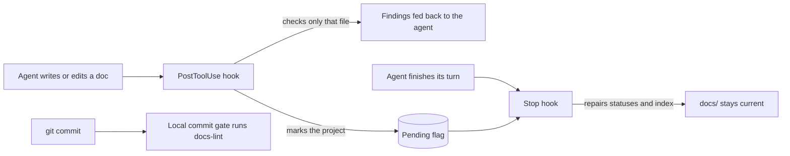

# Struct Docs

**Documentation structure your coding agents can't drift from.**

Struct Docs is a plugin for Claude Code, Codex and Antigravity that turns a project's `docs/`
folder into a checked contract. A small, configurable frontmatter schema says what every
document is, where it belongs and which topics it owns. A deterministic CLI enforces it, so the
mechanical work most teams spend model tokens on (routing, naming, cross-references, roadmap
status, keeping the index current) costs nothing and never guesses.

```text
$ docs-lint audit
specs/Session_Notes.md:1 - filename stem `Session_Notes` is not kebab-case
specs/Session_Notes.md:3 - type `review` is not permitted here - expected `spec`
specs/auth.md:6 - topic `auth` is also owned by specs/login.md:6
roadmaps/launch/index.md:5 - status is todo, should be in-progress (repairable with --fix)

$ docs-lint status
launch [in-progress]
  [x] auth
  [ ] billing  (needs auth)
  [ ] invites  (needs billing)

next: billing
```

## Why

Agents read documentation to decide what to build, and they write it as they go. Without
structure, the docs slowly lose their authority: two specs claim the same behavior, a review
lands among the specs, a roadmap says "todo" for work that shipped last week, and every session
burns context reading files to work out which one is current.

Struct Docs keeps the answer to "where does this go, and which document is the truth?"
mechanical:

- **Every document declares what it is.** `title`, `type` and `purpose` are required, and the
  directory decides which types are allowed. Misfiling is a finding, not a judgement call.
- **Topics have one owner.** A document can claim topics with `owns`, and two claims on the same
  topic fail the audit, so competing sources of truth surface before anyone reads them.
- **Roadmaps are data.** Milestones, acceptance criteria and dependencies follow a strict grammar.
  Parent statuses are derived, cycles and dangling dependencies are errors, and `status` names
  the next task that is ready to start.
- **Derived values have one writer.** The CLI owns roadmap rollups and the routing index in
  `docs/README.md`; hooks keep them current while the agent works.
- **Silence means clean.** A clean audit prints nothing, which keeps it cheap enough to run on
  every commit.

## How it works



- **While writing.** After each write, a hook checks only the written file (naming, placement,
  frontmatter) and feeds bounded findings straight back to the agent. It never repairs anything
  and never scans the tree, so it stays fast enough to sit on every edit.
- **At the end of a turn.** If any docs changed, the Stop hook repairs derived roadmap statuses
  and the index, then clears its flag only after the repair succeeds.
- **At commit time.** `init` can generate a project-owned CLI with optional house-style rules
  (line length, heading gaps, stale pointers, file size) and wire it into your pre-commit hook or
  check script. Those local rules keep working even on a machine without the plugin.

## Engineering highlights

- **One plugin, three hosts.** Skills, hooks and CLI are identical in Claude Code, Codex and
  Antigravity. Host differences live only in the manifests and a small payload adapter, which is
  tested against sanitized payloads captured from live sessions of each host.
- **No install step for users.** The CLI ships as a single committed esbuild bundle with
  Commander and a real YAML parser built in. Installing the plugin adds no dependencies to the
  consuming project.
- **Enforced architecture.** The TypeScript source is split into `policy`, `read`, `render`,
  `roadmap`, `check`, `repair` and `commands` layers. A custom ESLint rule enforces which layer
  may import which, including absolute imports.
- **Pure rules.** Every rule takes one parsed document and returns findings. Rules never touch the
  filesystem, print or set exit codes, so each one is testable with a plain object and can be
  copied into a project unchanged.
- **Generated code is verified, not trusted.** The bundle, the project CLI kit and the shared
  hook module are rebuilt in a temporary directory on every check and compared byte for byte
  with what is committed.
- **Strict by default.** TypeScript with no `any` and no enums, a 99-line code limit per source
  file, and 300+ tests on Node's built-in runner covering process exits, preserved authored
  content and repair idempotence.
- **Built with itself.** This repository's own [`docs/`](docs/README.md) is audited by its own
  CLI, and its development is planned and tracked in its own roadmap format
  ([v1 roadmap](docs/roadmaps/v1/index.md)).

## Install

Node 22 or later. Clone once:

```sh
git clone <repository-url> /path/to/struct-docs
```

### Claude Code

Try it for one session:

```sh
cd /path/to/your-project
claude --plugin-dir /path/to/struct-docs
```

To install it permanently, put the checkout in a local marketplace directory and add that
directory:

```sh
mkdir -p /path/to/marketplace/.claude-plugin /path/to/marketplace/plugins
git clone <repository-url> /path/to/marketplace/plugins/struct-docs
printf '%s\n' '{"name":"local","owner":{"name":"local"},"plugins":[{"name":"struct-docs","source":"./plugins/struct-docs"}]}' > /path/to/marketplace/.claude-plugin/marketplace.json
claude plugin marketplace add /path/to/marketplace
claude plugin install struct-docs@local
```

A `--plugin-dir` session records no install, so if `init` generates a project CLI, set
`STRUCT_DOCS_ROOT=/path/to/struct-docs` where you commit, or its structural checks are skipped.

### Codex

Register a local marketplace (the same directory works for both hosts) and install:

```sh
mkdir -p /path/to/marketplace/.agents/plugins /path/to/marketplace/plugins
git clone <repository-url> /path/to/marketplace/plugins/struct-docs
printf '%s\n' '{"name":"local","plugins":[{"name":"struct-docs","source":{"source":"local","path":"./plugins/struct-docs"}}]}' > /path/to/marketplace/.agents/plugins/marketplace.json
codex plugin marketplace add /path/to/marketplace
codex plugin add struct-docs@local
```

Enable hooks with `codex --enable hooks`, or set `hooks = true` under `[features]` in
`~/.codex/config.toml`. Codex fingerprints plugin hooks and asks you to trust them before
running `PostToolUse` and `Stop`: approve the prompt when starting a session in your project,
or pass `--dangerously-bypass-hook-trust` for non-interactive `codex exec` runs.

### Antigravity

```sh
agy plugin install /path/to/struct-docs
```

Or place a copy under `<your-project>/.agents/plugins/struct-docs`.

Installed plugins are snapshots: after pulling a newer version, update or reinstall it in
each host.

## Skills

Invoke as `/struct-docs:<name>` in Claude Code, `$struct-docs:<name>` in Codex, or by name in
Antigravity.

| Skill | What it does |
| --- | --- |
| `init` | Surveys existing docs, legacy config and references, then proposes a concrete plan (config, per-file moves, `owns` topics) and changes nothing until you approve it. |
| `audit` | Runs the structural checks, relays `file:line` findings, repairs derived values on request, and reports roadmap progress and the next task. |
| `roadmap` | Creates a roadmap of demonstrable milestones, or breaks one milestone out into tasks when work starts. |
| `review` | Writes a code or feature review from the project's template, with rated findings. |
| `fold` | Merges named loose notes or legacy decisions into the specs that own them, then removes the originals. |
| `execute-roadmap` | Validates the whole dependency graph, then works through a roadmap or milestone on a dedicated branch: delegates each task, verifies it, commits it, fixes ordinary failures within a bounded budget, and stops at the first real blocker. It never pushes or merges. |

## CLI

Run from your project, or any directory inside it:

```sh
node /path/to/struct-docs/bin/docs-lint.mjs init                # preview setup
node /path/to/struct-docs/bin/docs-lint.mjs audit               # full structural check
node /path/to/struct-docs/bin/docs-lint.mjs audit --fix         # plus derived repairs
node /path/to/struct-docs/bin/docs-lint.mjs check docs/specs/auth.md
node /path/to/struct-docs/bin/docs-lint.mjs repair
node /path/to/struct-docs/bin/docs-lint.mjs status
```

- `init --apply` applies safe setup after the approved changes. Add
  `--project-cli <rules>` for a project-owned `tools/docs-cli/` with house-style rules, and
  `--commit-gate auto` to run it on every commit.
- Findings use `file:line - problem`. Errors exit 1; usage and execution failures exit 2.
  Warnings and repairable values never fail the gate.
- `status` is read-only: it prints the progress tree and the next ready task, or why none is
  ready.

## Configuration

One root `.struct-docs.yml` maps `docs/` directories to document types and their fields. With
no file, sensible defaults apply. This repository's own configuration, condensed:

```yaml
living:
  gitignored: true
doctypes:
  product:
    type: prd
  specs:
    type: spec
    fields:
      status: { kind: enum, values: [draft, active, superseded], required: true }
      superseded-by: { kind: reference }
  reviews:
    type: review
    owns: false
    gitignored: true
    fields:
      subject: { kind: string, required: true }
      template: { kind: reference, to: templates, required: true }
```

Field kinds are `string`, `enum`, `list` and `reference`. The base fields and the roadmap
grammar are locked, so every project stays readable by the same tooling. Full details are in
the [configuration spec](docs/specs/config.md).

## Development

```sh
npm ci
npm run build      # regenerate the committed bundle and generated files
npm run check      # lint, type check, tests, manifest checks, byte-for-byte freshness
node tools/plugin-files.mjs claude plugin validate --strict
node tools/plugin-files.mjs agy plugin validate --strict
```

The specs in [`docs/specs/`](docs/README.md) are normative: when code and a spec disagree, the
code changes. To rehearse roadmap execution on a disposable project, run
`npm run rehearse:execution -- success` and point `execute-roadmap` at the returned project's
`docs/roadmaps/release/index.md`. The [fixture guide](tests/fixtures/execution/README.md)
documents the blocking variants, and [execution evidence](tests/fixtures/execution/evidence/task-loop.md)
records real delegated runs.

## Status

Struct Docs is pre-1.0. Six of the seven v1 milestones are done; the last converts an existing
manage-docs project to Struct Docs. Progress lives in the [v1 roadmap](docs/roadmaps/v1/index.md).
